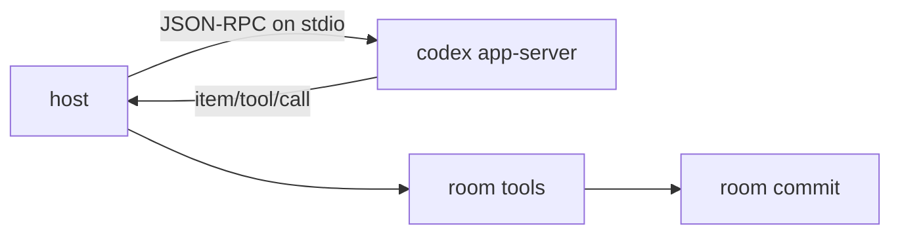

# Codex

`@ambionframework/codex` runs an Ambion seat on `codex app-server`. [Use an
executor](executors.md#use-an-executor) holds the install, the shared
options, the wiring, the sign-in rules, and the shared troubleshooting. This
page holds what differs for Codex. [The README](../README.md) holds the
positioning.

## What the package is

**A seat that Codex runs.** `codex()` defines the executor of an agent.
`codexExecution()` gives a room or a runtime the services that run it. Codex
owns the model loop and its thread. The host calls the tools of the seat
through the room.

**The kernel gains no dependency.** `@ambionframework/ambion` imports no model
library. `@openai/codex` belongs to this package only, pinned to the exact
version 0.160.1. The package brings the `codex` binary for the platform, and
the executor finds it from `@openai/codex/package.json`. Set `codexPath` on
`codexExecution()` to run another executable.

## Sign in

**Sign in with one of two ways.**

- Set `CODEX_API_KEY` in the environment of the process. The executor logs in
  with the key before it opens a thread, and Codex keeps the key in memory.
  Codex writes no `auth.json`. The app-server does not read the variable.
- Run `codex login` once. The seats link the sign-in file that the command
  writes, `~/.codex/auth.json`. Sign in with ChatGPT to run on a ChatGPT
  Plus or Pro subscription. A host with no browser runs
  `codex login --device-auth`.

**A key wins over `auth.json`.** A seat with `CODEX_API_KEY` ignores the
linked file, as `codex exec` does. For a subscription, leave `CODEX_API_KEY`
out of the environment. A login that Codex refuses is a permanent failure. Its
message names the cause and never holds the key. A login with no answer in 30 seconds is a transient failure. Codex reports no
cost, so the executor records none.

**The seats of an execution share a Codex home of their own.** The default
home is `~/.ambion/codex`, under the `HOME` of the host. The execution sets
`CODEX_HOME` to it for each run of the binary, and the `CODEX_HOME` of the
host never reaches the binary. A seat reads no `config.toml` and no
`AGENTS.md` from `~/.codex`, and it starts none of the MCP servers that
file names. The home persists, so a thread survives a restart of the host.
The execution creates it with the mode `0700`, because it holds full
transcripts, logs, and the linked login.

**The home links the login of the host.** The first activation creates the
symbolic link `auth.json` in the home. It points to `auth.json` in the
`CODEX_HOME` of the host when that variable is set, else to
`~/.codex/auth.json`. The host and all seats then share one login, because
Codex rotates the refresh token in place. A `HOME` that `env` sets moves the
default. The `login` option names another file.

- A home that already holds an `auth.json` keeps it. The execution never
  replaces or edits that file.
- A host with no login file gets no link. A seat on `CODEX_API_KEY` needs
  none. `login: false` links nothing in any case.
- Where the host refuses symbolic links, such as Windows with no privilege,
  the execution makes a hard link. If both fail, the activation fails as
  permanent. The message names both paths.
- Several activations can start at once. A link that another activation made
  counts as success.

**A keyring login cannot be shared.** With `cli_auth_credentials_store`
set to `keyring`, or to `auto` on a host with a keyring, Codex stores the
login in the keyring under a key that holds a hash of the `CODEX_HOME` path.
A seat home has another path, so it finds no login. Set the store to `file`
in `~/.codex/config.toml` and run `codex login` again. Or sign in to the
home: `CODEX_HOME=~/.ambion/codex codex login`.

## A complete example

```ts
import {
  createRuntime,
  defineAgent,
  definePerson,
  isSaid,
  startRoom,
} from '@ambionframework/ambion';
import { codex, codexExecution } from '@ambionframework/codex';
import { memoryJournals } from '@ambionframework/journal';

const planner = defineAgent({
  name: 'planner',
  identity: 'Reads the plan and names what is missing.',
  executor: codex({
    instructions: 'Speak when the plan lacks evidence.',
    model: 'gpt-5.6-luna',
    modelReasoningEffort: 'medium',
  }),
});

const priya = definePerson({ name: 'priya', identity: 'Project manager.' });

const runtime = createRuntime({ storage: memoryJournals() });
const room = await startRoom({
  runtime,
  name: 'delivery',
  agents: [planner],
  execution: codexExecution(),
});
const visit = await room.visit(priya);
const exchange = await visit.send({ text: 'Is the plan ready?' });
const messages = await exchange.waitForClose();
console.log(messages.filter(isSaid).map((message) => message.text));
await room.stop();
```

**A seat gets files and a shell from a workspace.** Give the seat the tools
of a workspace in `bundles` ([Workspace](workspace.md#give-the-resource-to-an-agent)).
The tools run behind the workspace port, so the backend is a choice of the
host: in memory here, a directory, or a workstation.

```ts
import { defineAgent } from '@ambionframework/ambion';
import { codex } from '@ambionframework/codex';
import { memoryBackend } from '@ambionframework/just-bash';
import { openWorkspace } from '@ambionframework/workspace';

const workspace = openWorkspace({ name: 'site', backend: { bash: memoryBackend() } });

const writer = defineAgent({
  name: 'writer',
  identity: 'Writes the notes of the site.',
  executor: codex({
    instructions: 'Keep the notes in your workspace, and say where they are.',
    model: 'gpt-5.6-luna',
    bundles: [workspace.tools()],
  }),
});
```

## Options

**`codex(options)` takes the [shared options](executors.md#options-every-executor-takes)
and three settings of the model.** The executor passes each setting to
`codex app-server`.

| Option                 | Required | Default       | What it does                                                                                          |
| ---------------------- | -------- | ------------- | ----------------------------------------------------------------------------------------------------- |
| `model`                | Yes      | None          | A Codex model identifier                                                                              |
| `modelReasoningEffort` | No       | Codex default | `minimal`, `low`, `medium`, `high`, `xhigh`, `max`, `ultra`, or `persistent`, as the model lists them |
| `reasoningSummary`     | No       | `'auto'`      | `auto`, `concise`, `detailed`, or `none`: see [Debug an activation](#debug-an-activation)             |

**The executor fixes the policy of the thread.** A seat has no option for
it. The executor sets `sandbox` to `read-only`, `approvalPolicy` to
`never`, and `cwd` to an empty temporary directory. [The trust boundary](#the-trust-boundary) states
why.

**`codexExecution(options)` takes the options of the executable.**

| Option      | Default                                      | What it does                                                                              |
| ----------- | -------------------------------------------- | ----------------------------------------------------------------------------------------- |
| `codexPath` | The bundled binary                           | A `codex` executable to run                                                               |
| `env`       | None                                         | Variables to lay over the allowlisted variables of `process.env`. `undefined` removes one |
| `home`      | `.ambion/codex` under the `HOME` of the host | The Codex home of every seat                                                              |
| `login`     | The `auth.json` of the host                  | The `auth.json` to link into the home. `false` links nothing                              |

**The defaults of `home` and `login` read the host.** They use the `HOME`
and the `CODEX_HOME` of `process.env` with `env` laid over them. Neither value
reaches the binary.

**The binary runs with an allowlisted environment.** The base is the
variables of `process.env` that pass: `PATH`, `USER`, `LOGNAME`, `TMPDIR`,
`TEMP`, `TMP`, `TZ`, `LANG`, `USERPROFILE`, `APPDATA`, `LOCALAPPDATA`,
`SYSTEMROOT`, `COMSPEC`, `PATHEXT`, `HTTP_PROXY`, `HTTPS_PROXY`, `ALL_PROXY`,
`NO_PROXY`, `http_proxy`, `https_proxy`, `all_proxy`, `no_proxy`,
`NODE_EXTRA_CA_CERTS`, `SSL_CERT_FILE`, `SSL_CERT_DIR`, `CODEX_API_KEY`,
`CODEX_ACCESS_TOKEN`, and `CODEX_CA_CERTIFICATE`. Windows compares these
names without case. Two prefixes pass, `OPENAI_` and `LC_`. The `env` option lays over the base: a
value adds or replaces a variable, and `undefined` removes one. Then the
execution sets the variables of the seat, and they win over `env`. Every run
of the binary gets the same environment, the `codex debug models` run for the
catalog included.

**Every other variable stays with the host.** `SHELL` and `TERM` are not on
the list, because a seat has no native tool and no terminal. Other `CODEX_`
variables, such as `CODEX_SQLITE_HOME` and `CODEX_SANDBOX`, move the state,
the sandbox, or a server of Codex out of the seat. A cloud key, a token of a
code host, and the socket of an SSH agent reach no process. A provider with
another `env_key` in the `config.toml` of `home` needs that variable in
`env`. Pass `OPENAI_API_KEY: undefined` and `CODEX_API_KEY: undefined` in
`env` to keep both from the `codex` process, and sign in with `codex login`.

**The seat sets `CODEX_HOME`, `HOME`, and `USERPROFILE`.** `CODEX_HOME` is
`home`. `HOME` and `USERPROFILE` are the private directory `home/home`, which
the execution creates with the mode `0700`. Codex finds skills under
`$HOME/.agents/skills`, so a skill of the host user reaches no prompt and no
dotfile of the host user is in the reach of the binary. The login still
works, because `auth.json` lives in `CODEX_HOME`.

## How a room tool reaches Codex

**The room tools are dynamic tools of the thread.** The room tools (`say`,
`schedule`, `seat`, `unseat`, `dismiss`, `recall`) and the tools of the
agent live in the host. The executor lists each one in the `dynamicTools`
parameter of `thread/start`, with its description and its JSON Schema. No
server runs beside the process, and no socket or bridge exists. The call goes
to the host, which calls the room, and the room checks it, so no approval
mode is needed.



1. The model calls a tool. Codex sends the notification `item/started` with
   an item of the type `dynamicToolCall`.
2. Codex sends the request `item/tool/call` to the host, with the call id,
   the tool name, and the arguments.
3. The executor runs the call on the tool that the core bound. It gives the
   tool the step id that `steps.idOf(turnId, callId)` returns for the pass
   and the call. It answers with `contentItems` and `success`.
4. Codex sends `item/completed` and gives the answer to the model.

**An answer holds text and images.** A text part becomes an `inputText`
item. An image part becomes an `inputImage` item with a data URL. `success`
is `false` when the tool reports an error or throws. The model then reads
the message as the tool output.

**The host refuses every other request of the server.** Codex can ask for
an approval, a user input, or a token refresh. The executor answers each
with the error code -32601 and keeps a warning `notice` that names the
method. `approvalPolicy` is `never`, so a seat does not see the first two.

**A thread keeps its tools.** Codex writes the dynamic tools in the first
line of the rollout file of the thread. `thread/resume` takes no tool list.
[Exchange continuity](#exchange-continuity) states the rule that follows.

## How an activation runs

[How an activation runs](executors.md#how-an-activation-runs) states the
read position.

**One process serves one activation.** The executor starts
`codex app-server` with the config flags of the seat, sends `initialize`
and the `initialized` notification, and opens a thread. The first pass sends
`turn/start` with the view. A later pass sends the delta as the next
`turn/start` of the same thread. Codex calls the object that `turn/start`
creates a turn. One pass runs one Codex turn, and this page says pass. The
process stays up between passes and stops at `close`.

**The thread parameters carry the seat's part.** `thread/start` takes
`baseInstructions`, the seat text: the note of the executor, the mechanism,
and the agent instructions, in that order, with a blank line between them.
The core fixes all three for an activation, so the executor builds the text
once. `baseInstructions` replaces the base prompt of Codex, which teaches
`apply_patch` and the shell. A seat has no native tools and needs nothing from
that prompt. The text arrives unchanged.

**The echo of the input is the signal that the model read it.** Each
`turn/start` and `turn/steer` carries a `clientUserMessageId`. When Codex
sends `item/completed` for the `userMessage` item with that `clientId`, the
executor calls `read` with the range of the view or the delta. A tool result
reaches the model when the tool returns, so the executor calls `delivered` at
once.

**A pass ends on `turn/completed`.** The `status` tells whether the pass
completed, failed, or was interrupted. A `failed` status carries a
`codexErrorInfo` that the classifier reads.

**Codex takes a steer.** The executor sends `turn/steer` with the `turnId` of
the pass as `expectedTurnId`. Codex echoes the line as a `userMessage` item,
the executor calls `read`, and the core records `consumed: true`. A line that
arrives before `turn/start` answers waits for the answer. A line that arrives
after the pass ended waits for the next delta, and the core records
`consumed: false`. Codex refuses `turn/steer` with the error code -32600 when
the pass is already over. The line is not read, and the next pass carries it.

**A cut interrupts the pass.** The signal of the activation makes the
executor send `turn/interrupt`. The pass settles when `turn/completed`
arrives, or after a grace period of 5 seconds. A cut is no failure.

**`close` stops the process.** It ends the input of the process and sends
SIGTERM. A process that is still alive after 2 seconds gets SIGKILL. A host
that dies takes `codex app-server` with it: the OS closes the pipe, and the
process ends.

## Step mapping

[Traces](traces.md#the-steps) holds the step kinds.
The table below gives the Codex source of each step.

**Each item that Codex reports becomes steps in the trace.** Codex streams the
text of an item in deltas and sends the whole item at `item/completed`. The
executor maps each delta to a step and the completed item to a closing step.

| Codex item or notification        | Steps                                                                                                           |
| --------------------------------- | --------------------------------------------------------------------------------------------------------------- |
| `agentMessage`                    | `text` deltas, then a closing `text`                                                                            |
| `reasoning`                       | `thinking` deltas, then a closing `thinking`; a new summary part starts after a blank line                      |
| `dynamicToolCall`                 | `tool_call` and `tool_result`; a room tool has its own name                                                     |
| `warning`                         | `notice` at level `warning`, with the message of Codex, up to 2000 characters                                   |
| `configWarning`                   | `notice` at level `warning`, with the summary and the details                                                   |
| `deprecationNotice`               | `notice` at level `warning`                                                                                     |
| `error` with `willRetry`          | `notice` at level `warning`, such as "Reconnecting... 1/5"                                                      |
| Any other item                    | `notice` at level `warning` that names the item type, when the item completes                                   |
| `thread/start` or `thread/resume` | Once for each thread: `session`, and a `notice` at level `info` with the thread, the home, and the rollout file |
| `thread/tokenUsage/updated`       | `usage`                                                                                                         |
| `turn/completed` with `failed`    | No step; the failure goes to the `end` step                                                                     |

**The `session` step opens the activation.** The executor records it after
the thread opens. It holds the name `codex`, the version of the binary, the
model, the working directory, the thread id, the sign-in kind that
`account/read` reports (`none` when Codex reports no account), the
permission mode `approvalPolicy, sandbox`, the names of the bound tools, and
the MCP servers that `mcpServerStatus/list` reports.

**The id of a step is unique in the room.** A real `codex` numbers the items
of each pass from `item_0`. The id of a step holds the activation id, the
`turnId`, and the item id, as in `message:3:gpt:1:turn-1:item_1`. A room
tool takes that id as the key of its commit, so the say of each activation
lands under its own key.

**A tool call shows with its name.** A tool with a namespace shows as
`namespace__tool`, and a room tool with its plain name. The core raises no
tool event for a room tool that commits an entry; see
[The room tools](executors.md#the-room-tools). A `compose` call adds the
`approval` step and the nested steps with a `parent`. A failed tool call
carries the text of the answer, or "The tool failed.". An image of the answer
returns to its form in the trace: the bytes of a data URL, or the URL.

**An item of another type shows that a native tool exists.** A seat has no
native tool, so Codex reports only the items above. A command, a file
change, a web search, or a plan item means that a newer `codex` added a tool
that the recipe does not turn off. The trace keeps a warning `notice`:
"Codex reported a native <type> item. A seat has no native tools." The
executor maps nothing else from such an item.
[The trust boundary](#the-trust-boundary) states the guard. A notice never
gates the activation, and the trace keeps a repeated warning once for each
text.

## Usage

**One `usage` step follows each model request.** `thread/tokenUsage/updated`
reports the tokens of the thread. Its `last` field holds the request that
just ended, and the executor reads that one. The activation reports the
sum on `activation_end`. Codex reports no cost, so the `cost` field stays
absent. A room that budgets on cost needs its own price table.

**Input tokens include the cache.** The count is

```text
input      = inputTokens - cachedInputTokens - cacheWriteInputTokens
cacheRead  = cachedInputTokens
cacheWrite = cacheWriteInputTokens
output     = outputTokens
```

The three parts add up to `inputTokens`. A count that subtracts only the
cached tokens counts the cache writes twice. The count ignores
`reasoningOutputTokens`. The recorded runs do not show whether `outputTokens`
includes them.

## Debug an activation

**The trace shows each step of the model.** Give the `logger` option of
`createRuntime` a function that keeps the steps. The `end` step holds the
failure of a pass that failed.

**The reasoning summary feeds `thinking`.** Codex shows no raw reasoning. It
shows a summary that the model writes when the request asks for one. The
catalog of some models turns the summary off, so the executor asks for it:
`reasoningSummary` is `auto` by default and goes to Codex as
`model_reasoning_summary`. `concise` and `detailed` set the size. `none`
asks for no summary, and the request then has no `reasoning.summary` field.
The default trace policy cuts each thinking block to 280 characters. Set
`defineAgent({ trace: { thinking: 'full', toolOutput: 'full' } })` to keep all
of each block ([The policy](traces.md#the-policy)).

**One `notice` joins the trace to the full record of Codex.** The notice
has the text "Codex thread" and the level `info`. Its `data` holds the
`thread` id, the `home` of the seat, and the `rollout` path from
`thread.path`. The rollout is the file
`<home>/sessions/YYYY/MM/DD/rollout-<time>-<thread>.jsonl`. It holds the
instructions, every input and output item, the reasoning, and the tool calls.
Each thread has one notice for the activation. `logs_2.sqlite` in the home
holds the log of the `codex` process.

## Failures

[Failure classification](executors.md#failure-classification) states the
shared rule and the text set. The text set holds the words of the Codex
login.

**A failed pass carries a typed error.** `turn/completed` with the status
`failed` holds `codexErrorInfo`. When the error names an HTTP status in
`httpStatusCode`, the shared status rule applies to it. Otherwise the shared
text set reads the message. A text that names a full context window or a
spent output limit reports `stop: 'length'`, which is no failure.

**A process that exits during a pass is a transient failure.** The failure
message holds the reason (`exited with code 1` or `was stopped by SIGKILL`)
and the last 2000 characters of the stderr of the process. The room retries
the activation.

**A missing `codex` binary is permanent when the executor looks for it.**
The executor reads the model catalog from the binary. It throws
`PermanentError` when the platform has no binary, or when `@openai/codex`
is not installed and no `codexPath` is set. A `codexPath` that names no file
is transient: the message reads "could not start".

**A refused `initialize` or `thread/start` fails the pass.** The error of
the server is the message of the failure.

## Exchange continuity

[Exchange continuity](executors.md#exchange-continuity) states the rule, the
recorded session, and the fresh start.

**An activation resumes the thread that `spec.resume` names.** The release
records the thread id from the answer of `thread/start`. An activation whose
`spec.resume` names a Codex thread sends `thread/resume` with the id. Every
other activation starts a fresh thread.

**A resume needs the same tools.** The rollout file of the thread keeps the
dynamic tools of its start, and `thread/resume` takes no new list. The
executor compares the tools in the first line of the rollout file with the
bound tools. When they are equal, it resumes. When they differ, it starts a
fresh thread.

**A resume that Codex cannot honor starts a fresh thread.** An error of
`thread/resume`, such as an unknown thread id, makes the executor start a
fresh thread, run the same prompt, and record the new id. The trace keeps a
`notice` at level `info` with the text "Codex thread not resumed". A dead
process is an ordinary failure, and the executor does not start a fresh
thread for it.

**A resume reads no history and counts no earlier usage.** The executor sends
`excludeTurns: true` with `thread/resume`, so Codex hydrates no history and
sends no `deprecationNotice`. Right after `thread/resume` answers, Codex
repeats `thread/tokenUsage/updated` for the last pass of the earlier
activation. The executor drops a usage note when no pass runs or when its
`turnId` differs from the running pass.

**A resumed thread takes the seat text of its own activation.**
`thread/resume` takes `baseInstructions`, so the thread follows the new text
and drops the old text. The first prompt of a resumed activation holds the
view alone, as the first prompt of a fresh thread does.

**Threads live in the Codex store of the seat home.** Codex persists threads
under `sessions` in the home, `~/.ambion/codex/sessions` by default. A host
that loses that directory falls back to a fresh thread. Give `home` a
directory that persists. Codex refuses to create its helper binaries under a
temporary directory.

## The trust boundary

**A seat has no native tools, ever.** Files and a shell come only from the
workspace tools, behind the workspace port, whether the workspace is in
memory, a directory, or a remote workstation. The seat has the room tools and
the tools of `tools` and `bundles`. No option gives a seat the shell, the file
edits, the web search, or the sandbox of Codex. The workstation backend needs
no separate guard against a native command.
[Trust](trust.md#what-each-harness-exposes) compares the three kinds.

**Code Mode ignores the sandbox.** Code Mode is a JavaScript runtime that the
model calls through `exec` and `wait`. Its JavaScript can read host files on
a read-only sandbox, as seen on 0.155.1, so `sandboxMode` and permission
profiles do not confine it. A feature flag cannot turn it off on 0.160.1,
because the model catalog turns it on.
The recipe therefore patches the catalog. The header of `src/catalog.ts` holds
the evidence.

**The recipe replaces the catalog entry.** A custom catalog overrides the
entry of a model. The executor runs `codex debug models` on the installed
binary once for each binary in the process, patches the entry of the seat
model, writes the catalog to a temporary directory, and passes the path as
`model_catalog_json`. `src/catalog.ts` holds the exact fields, the features,
and the reason for each. The recipe has five parts:

1. **The catalog entry.** The patch removes Code Mode, the patch tool, the
   search tool, and the usage instructions of apps, plugins, and skills. It
   leaves `input_modalities` and `supports_image_detail_original` as the entry
   has them.
2. **The features.** The config sets 37 features to `false`, among them
   `shell_tool`, `unified_exec`, `code_mode`, `apps`, `plugins`,
   `computer_use`, `multi_agent`, `hooks`, and `view_image`. This removes the
   shell, the tools that a feature adds, and the features that act on the host
   or the network, such as `shell_snapshot`. `memories` is off by default, and
   the entry keeps the `config.toml` of the seat home from turning it on.
   Codex turns `unified_exec` on again unless a managed requirement pins it,
   and it adds no tool while `shell_tool` is off (tested on 0.158.0). Features
   that stay on by default give no tool, and `codex features list` prints
   removed flags, such as `steer` and `sqlite`, as on (tested on 0.158.0). A
   removed flag has no effect.
3. **The tool switches and the skills.** `web_search` is `'disabled'`.
   `update_plan` and `experimental_request_user_input` are disabled.
   `skills.include_instructions` and `skills.bundled.enabled` are `false`,
   so no `skills_instructions` message reaches the model and Codex installs
   no system skill in the seat home.
4. **The bundled REPL.** The config declares `mcp_servers.node_repl` as
   disabled, by name. Without it the tool list holds `mcp__node_repl.js`.
5. **Defense in depth.** The thread runs on a read-only sandbox, with no
   network, no approval, and an empty temporary directory as its working
   directory. No repository and no host file is the default context.

**The recipe turns off the traffic and the state that a seat does not
need.** `check_for_update_on_startup`, `analytics.enabled`, and
`feedback.enabled` are `false`. Only the terminal interface of Codex reads
`check_for_update_on_startup`, and `codex app-server` starts no update check.
The config sets the key so that a later version keeps the same behavior.
`memories.generate_memories`, `memories.use_memories`, and the `memories`
feature are `false`. With a dummy API key, a run makes no request except the
model requests and opens no outbound connection. The binary tier asserts it.
A seat on a ChatGPT sign-in is the case that the keys protect, and the binary
tier does not run it. The temporary directory of an activation holds the
patched catalog and the empty working directory. The executor removes it when
the activation closes, and at process exit.

**A model with no catalog entry does not start.** The activation fails as
permanent, and the message names the model. The executor never leaves native
tools on by accident. Use a model that `codex debug models` lists.

**The version pin guards the recipe.** The feature names, the config keys,
and the catalog fields belong to the pinned `@openai/codex` version. A newer
`codex` can add a native tool that the recipe does not turn off, and it can
drop a key that the recipe sets. Codex then warns about the key. The binary
tier asserts that a default seat produces no warning `notice` and no skills
block, so such a change fails a test. Trust a new version only when the
binary tier and the live exclusivity test pass on it. The last troubleshooting
entry holds the procedure.

**An image from a tool of the seat reaches the model.** A tool that returns
an image part, such as the workspace `read` of a picture, sends the image to
a model that reads images. Codex puts it in the tool output as an
`input_image`, and the trace keeps the part. No native tool reads an image,
because the `view_image` feature is off. A model with no image input in its
catalog entry stays text-only, and Codex replaces the image with a text
placeholder.

**The seat home keeps the host config out, and the host owns the seat
config.** The execution points `CODEX_HOME` at the seat home, so the
`~/.codex` of the host user changes no seat: its `model_provider` reroutes no
request, its `mcp_servers` start no process, and its `AGENTS.md` joins no
prompt. The private `HOME` does the same for the skills of the host user. The
`config.toml` of the seat home is the responsibility of the host. The
executor overrides each config key that the recipe names. Any other key in
that file survives by a deep merge. An extra `[mcp_servers.<name>]` table
starts a server whose tools reach the host, and a `features.<name> = true`
entry turns on a feature that the recipe does not list. The default home
`~/.ambion/codex` holds no `config.toml` until a person writes one. Write only
keys that you trust.

**A linked login is shared with the host.** The seat home holds a link to the
login file of the host. A seat has no native tool, so no tool of the seat
reads or writes the seat home. The workspace tools reach the workspace
only. Set `login: false` and `CODEX_API_KEY` to give a seat no login file.

## Testing

**Three tiers test the package.**

| Tier   | What runs                                                                   | What it proves                                                     |
| ------ | --------------------------------------------------------------------------- | ------------------------------------------------------------------ |
| Fake   | A fake `codex app-server` through the `connect` option, over a real journal | The executor over the JSON-RPC protocol, with no process           |
| Binary | The bundled `codex app-server`, with a local endpoint that plays the model  | The recipe, the tool list, the thread, and the traffic             |
| Live   | The bundled binary on a real model                                          | The executor suite, and the exclusivity of tools with a real model |

The binary tier cannot prove that a model obeys: a scripted model does what
the script says, and it streams no deltas. Set `AMBION_LIVE_DUMP=<dir>` to
write one JSON file for each live case, with the room calls, every step, and
the prompt and the request of each pass.

**Run the live tier in one of two modes.** Every definition sets the model
`gpt-5.6-luna` and `modelReasoningEffort: 'medium'`. The mode `key` runs when
`CODEX_API_KEY` is set and pays the API account. The mode `login` runs when
`codex login` wrote `auth.json` and pays the ChatGPT subscription. The key
wins when the host has both, and a file skips when the host has neither.

```sh
CODEX_API_KEY=... pnpm --filter @ambionframework/codex run test:live
pnpm --filter @ambionframework/codex run test:live   # on the login
```

Unset `CODEX_API_KEY` to run on the login.

A live run costs money: run one file with
`pnpm --filter @ambionframework/codex exec vitest run
--config vitest.live.config.ts test/live/exclusive.test.ts`.

## Troubleshooting

[The shared table](executors.md#troubleshooting) lists the symptoms that
hold for every kind. These rows are specific to Codex.

| Symptom                                                   | Cause and fix                                                                                                                                                                                                                                                                                                                                                                                                                                                                                                                                                                                                                                                                                                                                                                                                                                    |
| --------------------------------------------------------- | ------------------------------------------------------------------------------------------------------------------------------------------------------------------------------------------------------------------------------------------------------------------------------------------------------------------------------------------------------------------------------------------------------------------------------------------------------------------------------------------------------------------------------------------------------------------------------------------------------------------------------------------------------------------------------------------------------------------------------------------------------------------------------------------------------------------------------------------------ |
| The seat answers in its final message and nobody hears it | Codex has its own final-answer channel. The room hears only `say`. The note at the start of the seat text says so. A seat that still ends with plain text shows a `text` step and no `tool_call` in its trace, and `activation_end` reports `said: false`.                                                                                                                                                                                                                                                                                                                                                                                                                                                                                                                                                                                       |
| The process does not start                                | The activation fails as transient, with "could not start" or "exited with code N" and the stderr of the process. Check that `codexPath` names an executable file, or that `@openai/codex` is installed for the platform. Run `<codex> app-server` in a terminal to see its error.                                                                                                                                                                                                                                                                                                                                                                                                                                                                                                                                                                |
| A thread cannot resume                                    | The executor starts a fresh thread, and the seat loses what the old thread held. The record still holds every line. Look for a missing `sessions` directory in the seat home, a changed `home` option, a `codex` of another version, a change of the bound tools (the notice "Codex thread not resumed" says it), or another account than the one that started the thread.                                                                                                                                                                                                                                                                                                                                                                                                                                                                       |
| A run fails with a sign-in message                        | The failure is permanent. Set `CODEX_API_KEY`, or run `codex login`. A `HOME` that `env` sets moves the default `login`. A login in the OS keyring is invisible to a seat: see [Sign in](#sign-in).                                                                                                                                                                                                                                                                                                                                                                                                                                                                                                                                                                                                                                              |
| A seat starts with no login although the host has one     | The host login file is `<CODEX_HOME>/auth.json` when the environment of the host sets `CODEX_HOME`, else `~/.codex/auth.json`. Check that path, or pass `login`.                                                                                                                                                                                                                                                                                                                                                                                                                                                                                                                                                                                                                                                                                 |
| `Cannot link .../auth.json to the login file ...`         | The activation could make neither a symbolic link nor a hard link, and the failure is permanent. Run `CODEX_HOME=<home> codex login` to sign in to the home, or pass `login: false` and set `CODEX_API_KEY`.                                                                                                                                                                                                                                                                                                                                                                                                                                                                                                                                                                                                                                     |
| A native tool shows up after a Codex upgrade              | The seat lists or calls a tool that is not a room tool and not one of yours, and the trace holds a warning `notice` that names an item type. A newer `codex` added a feature or a catalog field that the recipe does not cover. Run the binary tier (`test/binary.test.ts`), which asserts the exact tool list and no warning `notice` for a default seat, and run `test/live/exclusive.test.ts` to see the name. Compare `codex debug models` and `codex features list` of the new version with `src/catalog.ts`. Check each feature that is on by default in the new version against the comment of `EXCLUSIVE_FEATURES` in `src/catalog.ts`. Add the feature or the field, and keep the version pinned until both tests pass. A warning that names a config key means that the new version dropped the key: remove it from `exclusiveConfig`. |
