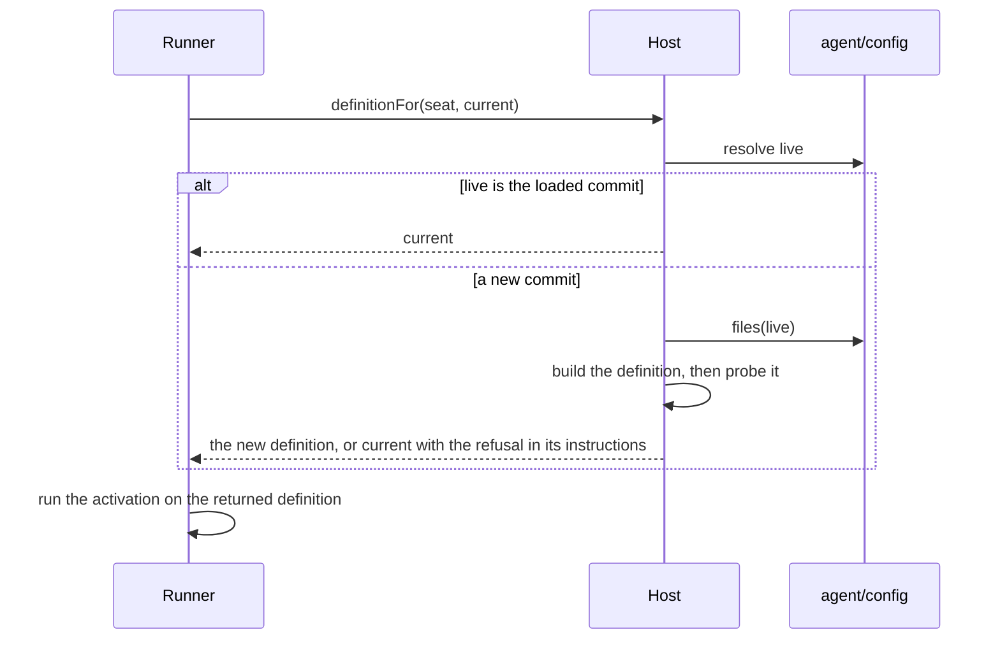
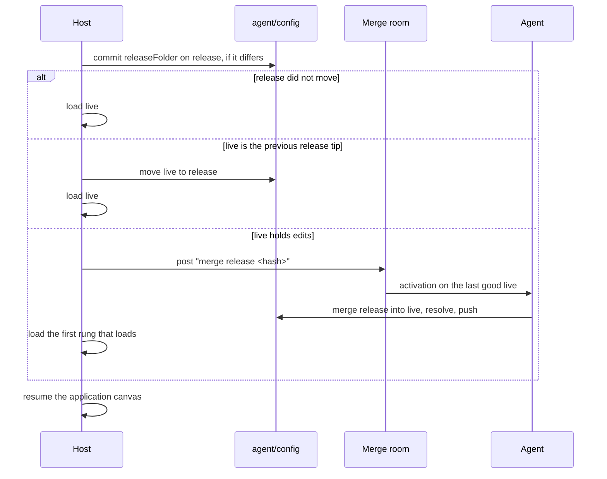

# Config repositories

**This page is a design. No package implements it yet.** It states the
interfaces, the formats, and the order of work that a developer needs. It
describes how each agent keeps its configuration in a private git
repository, how an edit takes effect at the next activation, and how a new
release reaches each agent at startup.

**The configuration of an agent is everything that shapes how it works.**
It is the instructions, the identity text, the skills, the macros of each
skill, and their scripts and references. One private repository holds it
for each agent: `<agent>/config`. The name is provisional.

## Decisions

- **Each agent sees only its own configuration and can edit all of it.**
  No agent reads or writes the configuration of another agent.
- **Two branches separate what ships from what runs.** `release` holds
  what ships with the code, and only the host writes it. `live` holds the
  version that the agent customized, and the host loads it.
- **Tools and credentials stay in host code.** An edit changes how an
  agent works. It cannot change what the agent can touch.
- **An edit takes effect at the next activation of the agent.** The room
  asks the host for the definition of a seat before each activation. An
  activation in progress never changes.
- **An agent with edits merges a new release into `live` at startup.** It
  works in a room that a person can visit.
- **The source repository is the one truth.** A developer folds the
  difference between `release` and `live` of each agent into the source
  for the next release.

## What the repository holds

| In `<agent>/config`                   | In host code, not editable |
| ------------------------------------- | -------------------------- |
| `instructions.md`, the instructions   | Tools and tool bundles     |
| `identity.md`, the identity           | Credentials                |
| `skills/<skill>/SKILL.md`, the skill  | Models and executors       |
| `skills/<skill>/macros/<name>.js`     | Limits and the roster      |
| `skills/<skill>/` scripts, references | The canvas and its rooms   |
| `.release.json`, on `release` only    | The trace policy           |

**The host builds a definition from the files.** It reads
`instructions.md` and `identity.md` as text. It removes the `skills/`
prefix from the other paths, because `loadSkills` expects
`<skill>/SKILL.md` at the root of a source, and passes them to
`loadSkills`. The layout is a convention of the host. `defineAgent` keeps
its strings and its skill set, so the layout adds no stored format.

**The release folder of an agent is a copy.** A host function
`releaseFolder(agent)` returns the files of the agent folder in the source
and a copy of each shared skill that the agent uses, under `skills/`. In
the repository of the agent, a shared skill is an ordinary folder that
the agent can edit.

**`.release.json` maps the release back to the source.** It holds
`{ "source": "<40 hex digits>", "files": { "<path>": "<source path>" } }`:
the commit of the source repository that the folder was built from, and
the source path of each file. The host writes it with the release commit,
and the agent cannot change it on `release`.

**A macro cannot widen what an agent can touch.** A macro binds only the
tools in its `uses`, and each must be a tool of the seat
([Skills and macros](skills.md#macros)). An edited macro chains the same
tools in another order.

## The repository and its branches

**`<agent>/config` is private.** The name `config` in the namespace of an
agent has a read rule that no other repository has: only that agent, and
the host acting for that agent, read it. The rule has four parts.

1. `readableBy(id, agent)` in `git-names.ts` returns true for every
   repository except `<other>/config`. `writableBy` is unchanged: the
   owner already pushes to the namespace of the agent.
2. `credentialFor` issues a credential for `<other>/config` to no agent.
   The just-bash backend issues `read` to every other agent today
   (`just-bash/src/git/backend.ts`), so it checks `readableBy` first.
3. `repos`, `list`, `get`, and `fork` skip or refuse a repository that the
   agent cannot read. The workstation `LIST_SCRIPT`
   (`git-repositories.ts`) filters the same way, and the forced command of
   each agent key (`git-prepare.ts`) allows `git-upload-pack` only on a
   repository that the key may read.
4. The guidance line "You can read every repository" names the exception.

**The two branches have rules in the server.** A server hook enforces
each rule, as the hook of the shared default branch does today.

| Branch    | Holds                            | Rule                                                |
| --------- | -------------------------------- | --------------------------------------------------- |
| `release` | One commit for each release      | Only the host pushes                                |
| `live`    | The customized version that runs | No deletion, and no push that is not a fast-forward |

**The host writes `release` through the registration path.** On the
just-bash backend, the path writes to the storage and skips the hook. On
the workstation, it uses the host key, which the hook allows.

**The first start creates the repository.** The host creates
`<agent>/config`, commits `releaseFolder(agent)` on `release`, and points
`live` at the same commit. The history of `live` keeps each edit, each
merge of a release, and each resolved conflict.

## The new operations of `GitEnv`

The host calls these through `git.use(agent, (env) => …)`. No agent tool
calls them. Each is an additive method, and each backend needs a
`GitConformance` case.

| Method                                                | Result                                                     |
| ----------------------------------------------------- | ---------------------------------------------------------- |
| `files(id, hash, signal?)`                            | `SourceFiles` of the tree of the commit, or `undefined`    |
| `isAncestor(id, ancestor, descendant, signal?)`       | `boolean`, or `undefined` when a commit does not exist     |
| `move(id, branch, to, from, signal?)`                 | `true` when the branch moved from `from` to `to`           |
| `commit(id, branch, files, message, parent, signal?)` | The hash of a new commit on `branch`, with parent `parent` |

**`move` and `commit` compare the old value.** A call fails when the
branch is not at `from` or `parent`. Two hosts that register the same
release then agree: the loser reads the branch again, finds the same tree,
and writes nothing, as template registration does
(`git-registration.ts`). `commit` writes a tree and a commit with no
working copy. `move` accepts a fast-forward only.

## Edit the configuration

**An agent edits its configuration like any other repository.** It clones
`<agent>/config`, works on `live`, commits, and pushes. The guidance of
the agent states three rules:

1. Push each edit. On `memoryBackend`, a commit that is not pushed is
   lost at a restart ([Persistence](git.md#persistence)).
2. Give the reason in the commit message, and cite the exchange that
   showed the need with a message ref.
3. Expect the edit to take effect at the next activation.

**The copy in `~/.skills` is not the configuration.** An edit of that copy
changes nothing that runs, and the copy step can restore it
([Skills](skills.md#the-copy-in-the-home)).

## Load at each activation

### The option

```ts
interface StartRoomOptions {
  /** The definition for the next activation of `seat`. Absent keeps the definition of the run. */
  readonly definitionFor?: (
    seat: string,
    current: AgentDefinition,
  ) => AgentDefinition | Promise<AgentDefinition>;
}
```

`startRoom`, `resumeRoom`, and `openCanvas` take the option. `openCanvas`
passes it to the rooms of every row, breakout rooms included. A row
resumes with its definitions fixed at `resume` (`canvas.ts`), so the
option cannot be an argument of `resume`.

**The host returns `current` when nothing changed.** The room treats a
throw, a rejection, and a call that passes the time bound as "return
`current`". The bound is the 5 seconds of a reminder
(`execution/reminders.ts`).



### Where the kernel reads the definition

The kernel reads the definition in four places. Only one of them changes.

| Place                                    | Reads                                    | After this design     |
| ---------------------------------------- | ---------------------------------------- | --------------------- |
| `runner.ts`, when it takes an activation | The whole definition                     | Calls `definitionFor` |
| `route.ts`, when the port is created     | `executor.kind`                          | Fixed for the run     |
| `connector.ts`, when the port is created | `trace`, the trace policy                | Fixed for the run     |
| `room.ts`, `tokenWindow`                 | `activationTokenLimit`, `estimateTokens` | Fixed for the run     |

**The room accepts a returned definition only when these fields equal the
current ones:** `name`, `identity`, `executor.kind`, `trace`,
`activationTokenLimit`, `estimateTokens`, and the tool names. Otherwise it
keeps `current` and emits a `port_error`. Only the instructions, the
skills, and the macros change. The journal records the name and the
identity in the cast, so an edit of `identity.md` takes effect at the next
start.

**The seat keeps one port.** The seat context and the connector request
hold a function `definition(): AgentDefinition`. `portFor` binds it to
`definitionFor` and to the last accepted definition. The queue of
activations stays, because the port stays. An activation in progress keeps
its definition. Two activations of one exchange can run on two commits.

### The executors

**Each executor holds the definition in a field for the life of its
port.** Pi (`execution.ts`), Claude (`executor.ts`), and Codex
(`executor.ts`) each copy `options.definition` when they connect. The
option `definition: AgentDefinition` becomes `definition: () => AgentDefinition`
in all three, and each reads it at the start of every activation.

| Executor | A changed agent part in a resumed session                                                                                                                                       |
| -------- | ------------------------------------------------------------------------------------------------------------------------------------------------------------------------------- |
| Pi       | Works once the executor reads the function: the harness renders the prompt before each request ([Pi](pi.md))                                                                    |
| Claude   | Works once the executor reads the function: the agent part goes at the head of the first message of a resumed session ([Claude](claude.md))                                     |
| Codex    | Needs code: `thread/start` fixes `baseInstructions`. The executor compares the agent part as it compares the tools, and starts a new thread when it differs ([Codex](codex.md)) |

### The skills

**The skills live in the tool bundle, not in the instructions.**
`workspace.tools({ skills })` binds the skill set, and its macros, to a
bundle with a copy memo for each agent. A new commit needs a new bundle.
The host builds the new definition with a new `workspace.tools({ skills })`
and the same executor, tools, and bundles otherwise. The tool names stay
equal, so the equality rule accepts it. The new bundle copies `~/.skills`
at the next respond activation.

### The probe

**The host checks a macro before it returns a definition.** `loadSkills`
checks the format of each macro. The check of the tools that a macro
names runs later, in `composeTools` (`compose-tool.ts`), on the first pass
of an activation. A macro that names a removed tool would fail there, after
the room accepted the definition. The host therefore builds the compose
tool of the seat with `composeTools` on the new set, as a probe, and
treats a refusal as a refused commit.

**A refused commit leaves `current`.** The host returns `current` with the
refusal added to its instructions: the commit, and the error of
`loadSkills`, `defineAgent`, or the probe. The text change is allowed by
the equality rule. The agent reads the error at its next activation and
can push a fix. The host adds a log entry.

**The host can pin a seat to one commit.** A pin makes the host return
that commit whatever `live` holds. A person uses it to stop a bad edit
until the agent fixes it. The host keeps the pins and the load log in its
own storage, outside the journal and outside the repository, because an
agent can edit the repository.

**The record and the promise do not change.** The option adds no journal
body, and the cast keeps the name and the identity. A new optional field
of the room options is additive. `planning/backlog.md` lists hot-loaded
definitions as deferred, so that line goes when this design lands.

## Startup

**A release lands at a start.** A new release comes with new host code,
so the host restarts. Edits between two starts need no merge: each one
loads at the next activation.



**Detect each case with `isAncestor`.** `live` holds the release when the
tip of `release` is an ancestor of `live`. `live` holds no edits when it
is an ancestor of the tip of `release`. Both can hold at once only when
the two are equal. An agent that resolves a merge by resetting `live` to
`release` therefore counts as merged.

**An agent with no edits merges nothing.** The host moves `live` to the
tip of `release` with `move`. No activation runs.

**An agent with edits merges in its own room.** The host opens a second
canvas on a canvas store of its own. A canvas resumes every row of its
store, so two canvases cannot share one. The canvas holds one root room
for each agent that must merge, named `config-<agent>`, and that agent is
the one seat. The two canvases share one runtime, so the application
reserves no room name with the prefix `config-`. The host does not mirror
these rooms, so no agent reads another merge. A person can visit a merge
room, read the conflicts, and answer the agent.

**The agent merges `release` into `live`.** It runs on its last good
`live`, so it resolves each conflict with the instructions under which it
made the edit. It uses its commit messages and the exchanges they cite. It
asks the person when its edits do not settle a conflict. The room records
how each conflict was resolved and why. The agent checks that each skill
still loads, then pushes `live`.

**The host loads the first rung that loads, for each agent.**

1. `live` after the merge.
2. The last commit of `live` that loaded.
3. The tip of `release`.

**The last good commit can fail on new host code.** A macro can name a
tool that the release removed, and the probe refuses it. The tip of
`release` always loads, because the developer tested it with that host
code.

**A merge that fails is kept.** On a deadline or an `exhausted` exchange,
the host loads the next rung and posts the outcome to the merge room.
`live` keeps what the agent pushed. The agent can finish the merge later,
and `live` then loads at its next activation.

### Failures at startup

| Failure                                              | Result                                                                                       |
| ---------------------------------------------------- | -------------------------------------------------------------------------------------------- |
| Two hosts commit `release` at once                   | `commit` compares the parent. The loser finds the same tree and writes nothing               |
| Two hosts move `live` at once                        | `move` compares `from`. The loser reads again                                                |
| A crash after the `release` commit                   | The next start derives the same case from git                                                |
| A crash after the post to the merge room             | The post names the release hash. The host reads the room record before it posts again        |
| A restart while a merge is in progress               | `live` is unchanged until the push. The merge canvas resumes the open exchange               |
| A breakout row names an agent that the release lacks | The row stays `running` at `resume` ([Canvas](canvas.md)). The release keeps each agent name |

## Record the version

**The trace records which commit ran each activation.** The host wraps
its `TraceLogger` and adds the loaded commit of `live` and the tip of
`release` to each step. The commit can change from one activation to the
next, so the trace is the one place that records it. A step already names
the room, the seat, the activation, and the exchange
([Executors](executors.md)). The host stores the trace, because a restart
keeps none.

**The host keeps one log entry for each load.** The entry holds the seat,
the commit, and the outcome: loaded, refused with the error, or pinned.
The journal holds nothing new.

## Fold the edits back into the source

**The customization of an agent is the difference between its branches.**
After a merge, `live` holds the current release and the edits of the
agent. The harvest script runs on the machine of the developer, on a clone
or a bundle of `<agent>/config`. It does five steps.

1. Read `.release.json` at the tip of `release`.
2. Check out a worktree of the source repository at `source`. `git apply
-3` needs the worktree at that commit.
3. Compute `git diff release live`.
4. Rewrite the path of each file with `files`, back to its source path.
   The skills of one shared skill map to the shared folder.
5. Apply the patch with `git apply -3` on a branch `harvest/<agent>`.

**A path outside the mapping is new or removed.** The script puts a new
file under the folder of the agent and lists it. It lists a removed file
without applying the removal.

**The developer folds one agent at a time.** Two agents that edited the
same shared skill give two patches. The developer merges them in the
source repository and picks one text for the next release.

**The host exports each repository.** On a workstation, the developer
fetches over SSH. With `justGitBackend`, the server runs in the host's
process, so a host script clones each repository and writes a git bundle.

## Trust

| Attempt                                                         | Result                                                                                                          |
| --------------------------------------------------------------- | --------------------------------------------------------------------------------------------------------------- |
| Edit its own instructions, skills, or macros                    | Allowed; takes effect at the next activation                                                                    |
| Read, clone, or fork the configuration of another agent         | Refused: the repository is private to its agent                                                                 |
| Push to `release`                                               | Refused: the host alone writes it                                                                               |
| Rewrite or delete `live`                                        | Refused by the server hook                                                                                      |
| Change a tool or a credential                                   | Not possible: host code                                                                                         |
| Delete every file on `live`                                     | Refused at load; `current` stays                                                                                |
| Read or change the working copy or `~/.skills` of another agent | Possible on the just-bash backends: no wall between homes. Refused on the workstation: each home is mode `0700` |
| Write text that enters another agent's prompt                   | Possible on the just-bash backends through the clone in another home. Refused on the workstation                |
| Read the edits of another agent in the audit log                | Possible on both backends when the workspace sets `audit`                                                       |

**Isolation needs the workstation and no audit log.** On the just-bash
backends, every agent can read every home ([Skills](skills.md#review-a-macro)),
so a clone or the skills copy of an agent is readable there. The audit log
holds the arguments and the result of each file and `bash` call, and every
agent can read it ([Workspace](workspace.md)). A host that needs isolation
runs the agents on a workstation and sets no `audit`.

**Use this design with trusted agents.** An agent rewrites its own
instructions, and the edit applies at once. A prompt injection that
reaches an agent can persist through its configuration until a person pins
the seat. A room open to untrusted agents loads `release` alone
([Trust](trust.md)).

## Tests

Tests follow `CLAUDE.md`: they run the real thing.

| Piece                                   | Test                                                                                                                  |
| --------------------------------------- | --------------------------------------------------------------------------------------------------------------------- |
| The private repository                  | A `GitConformance` case on both backends: another agent gets no credential, no listing, no fork, and no upload-pack   |
| The branch rules                        | A conformance case: only the host pushes `release`, and `live` refuses deletion and non-fast-forward                  |
| `files`, `isAncestor`, `move`, `commit` | A conformance case each, including the lost race of `move` and `commit`                                               |
| `definitionFor`                         | A scripted room on `memoryCanvas`: change `live` between two activations of one exchange, and check the second prompt |
| The equality rule                       | A returned definition with another identity or tool name is refused with `port_error`                                 |
| The executors                           | A scripted test for each: the function changes the agent part at the next activation. Codex also starts a new thread  |
| The probe                               | A macro that names a removed tool is a refused commit, and the instructions carry the error                           |
| The breakout resume                     | A row resumes with the option of `openCanvas`                                                                         |
| Startup                                 | Each case of the diagram on a real git backend, with a merge room on a scripted model                                 |
| The harvest                             | A fixture repository: the patch applies, and a new file is listed                                                     |

## The order of work

Each step ships alone with its tests. The release column is a proposal.

| Step | Delivers                                                                                             | Release                          |
| ---- | ---------------------------------------------------------------------------------------------------- | -------------------------------- |
| 1    | The private repository: `readableBy`, `credentialFor`, listing, `fork`, `serve`, with conformance    | Any, additive                    |
| 2    | `files`, `isAncestor`, `move`, `commit`, and the `release` and `live` hooks                          | Any, additive                    |
| 3    | The host commit of `releaseFolder` on `release`, with `.release.json`                                | Any, host code                   |
| 4    | The executor option `definition: () => AgentDefinition`, and the Codex new thread                    | 0.10.0, before the export review |
| 5    | `definitionFor` in `startRoom`, `resumeRoom`, and `openCanvas`, with the equality rule and the probe | 0.10.0, after the roster changes |
| 6    | The fast-forward, the merge canvas, the rungs, the pin, and the load log                             | After 1.0.0, host code           |
| 7    | The trace stamp, the harvest script, and the export                                                  | After 1.0.0, host code           |

**Steps 1 to 3 change no kernel behavior.** Step 5 is the one kernel
change. Step 4 changes an export of three packages, so it comes before
the export review.
