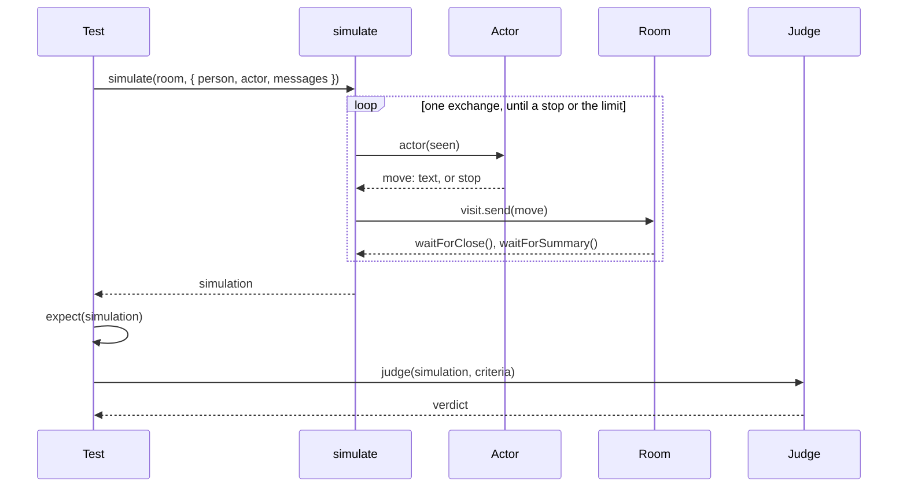

# The simulator

**`@ambionframework/simulator` runs evals.** The package holds
`simulate`, `scriptedActor`, `agentActor`, and `agentJudge`.

**The simulator runs an eval: an agent plays a person in a room, and the test
grades what the room did.** An eval has three parts. The actor sends each
question on behalf of a person. Checks in code assert facts on the record.
A judge grades the criteria that code cannot decide.

**The package holds one loop and two agents: the actor and the judge.**
The room, the record, and the waits come from the kernel. The scripted
execution comes from `@ambionframework/ambion/testing`. The model
resolution comes from `@ambionframework/pi`. The simulator adds the person
who drives the room and the judge who reads it.

## An eval as a test

**An eval is a vitest test.** It starts a room, runs the simulation, asserts
on the simulation, and asks the judge. The local `support.ts` holds the agent
definitions, the model ids, a runtime on the live model, and `stopAtEnd`.

```ts
import { definePerson, startRoom } from '@ambionframework/ambion';
import { agentActor, agentJudge, simulate } from '@ambionframework/simulator';
import { expect, it } from 'vitest';
import {
  assistant,
  JUDGE_MODEL,
  liveRuntime,
  MODEL,
  payroll,
  stopAtEnd,
  weather,
} from './support.ts';

const priya = definePerson({ name: 'priya', identity: 'Site manager. Pours concrete.' });

it('the assistant asks the weather desk once, and answers the person', async () => {
  const room = stopAtEnd(
    await startRoom({
      name: `pour-${crypto.randomUUID()}`,
      runtime: liveRuntime(),
      assistant,
      agents: [weather, payroll],
    }),
  );

  const simulation = await simulate(room, {
    person: priya,
    actor: agentActor({
      model: MODEL,
      brief: 'Find out if you can pour concrete on Thursday. Stop when you have a yes or a no.',
    }),
    messages: 3,
  });

  expect(simulation.ended).toBe('stopped');
  expect(simulation.exchanges.map((e) => e.view.outcome.kind)).not.toContain('exhausted');
  const seats = simulation.exchanges.flatMap((e) => e.view.activations.map((a) => a.seat));
  expect(seats).not.toContain('payroll');

  const verdict = await agentJudge({ model: JUDGE_MODEL })(simulation, [
    'The person learns whether Thursday is dry, with the forecast as the reason.',
    'No agent repeats a fact that another agent already said.',
  ]);
  expect(verdict.pass, JSON.stringify(verdict.findings)).toBe(true);
});
```



## Rules of the loop

- **The simulator drives a room that the test started.** `simulate` takes
  a running `Room`. The test chooses the runtime, the storage, the
  execution, and the definitions. The test stops the room with
  `stopAtEnd(room)`.
- **One iteration of the loop is one exchange.** The actor sends one
  message. The loop waits on the handle of that exchange. The loop never
  sends into an open exchange.
- **Every wait is a handle wait.** The loop uses `waitForClose()` and
  `waitForSummary()`. It never polls for a quiet room, and it never calls
  `reconcile()`.
- **The actor sees what a person sees.** It reads each discussion, each
  summary, and what its tools return. It reads no activation, no event, no
  trace, and no criterion.
- **Actor and judge are functions.** The `Actor` and `Judge` types hold the
  contract. A scripted actor and a scripted judge are ordinary values, so the
  scripted tier runs every path with no key.
- **One simulation is one sample.** The package repeats nothing. A test that
  wants several samples writes the loop.
- **A fixed question needs no agent.** Most assistant cases send one
  question and grade the answer. `scriptedActor([question])` drives a live
  room. An agent actor is for a case where the next message depends on the
  answer.
- **A controlled seat comes from the testing entry.** A seat whose
  evidence the test fixes runs on `scripted()` from
  `@ambionframework/ambion/testing`. The package adds nothing for it.

## The surface

| Export          | What it is                                                                  |
| --------------- | --------------------------------------------------------------------------- |
| `simulate`      | Runs the loop on a room and returns a `Simulation`                          |
| `Actor`         | `(seen: Seen) => Move \| Promise<Move>`: the person's next move             |
| `Judge`         | `(simulation: Simulation, criteria: readonly string[]) => Promise<Verdict>` |
| `scriptedActor` | An actor that plays a fixed list of moves                                   |
| `agentActor`    | An agent with tools that plays a person from a brief                        |
| `agentJudge`    | An agent with tools that grades a simulation                                |

## The loop

**`simulate` runs these operations in order.**

1. Subscribe to the room, and keep every notification in `simulation.events`.
2. Call `room.visit(person)` once.
3. Call `actor(seen)`. A `stop` move ends the loop with `ended: 'stopped'`.
4. Call `visit.send(move)`. The loop sends the next move only after the
   exchange closes, so each move opens one exchange. A message that joins
   an exchange that was already open, such as one the test left open,
   ends the loop with `ended: 'failed'`.
5. Wait on `handle.waitForClose()`, then on `handle.waitForSummary()`.
   Both waits share one deadline, `exchangeMs` after the send, because the
   summary is the answer a person reads. In a room with no summary writer,
   `waitForSummary()` returns `undefined` when the close lands.
6. At the deadline, call `room.cancel()`. Before the close, the cancel
   writes a close with the outcome `cancelled`, and the summary wait
   returns `undefined`. After the close, the cancel fails the pending
   summary, and `waitForSummary()` rejects. The loop waits for the cancel
   to land, so it cancels no later work. The loop ends with
   `ended: 'timeout'` after operation 7 when the outcome is `cancelled`, or
   when the landed cancel cut the summary. The closed view then shows the
   summary as `failed`. An exchange that ended by itself before the cancel
   landed keeps its summary, and the loop goes on. A cancel that rejects,
   or a close that does not land in a second period of `exchangeMs`, ends
   the loop with `ended: 'failed'`.
7. Read the closed `Exchange` from `room.read()`. Add the exchange to
   `simulation.exchanges`, and add the discussion and the summary to `seen`.
8. Go back to operation 3. After `messages` messages, end the loop with
   `ended: 'limit'`.
9. Call `visit.leave()`, read the room once more, and return the simulation.

**A rejected wait ends the loop with `ended: 'failed'`.** `waitForClose()`
rejects when the room stops. `waitForSummary()` rejects when a required
summary fails. The simulation keeps the error message in `simulation.error`. The loop
does not retry.

**The loop does not stop the room.** The test owns the room, and it can
read the room, or send into it again, after `simulate` returns.

**The first message goes out at once after the arrival.** An arrival can
wake a seat with `presence` attention. That activation keeps the room live,
so the first exchange closes after it ends. A person does the same: they
arrive and ask.

**Events start at the subscription.** A notification from before
`simulate` is not in `simulation.events`. The record holds every entry, so
`simulation.room` is complete.

## The actor

**An actor returns the next move from what the person has seen.** It is a
function, so an agent and a list have one shape.

**`scriptedActor` plays a list.** A string is a message to the room. A
`Move` is sent as it is. The actor stops when the list ends.

```ts
const actor = scriptedActor(['Can we pour on Thursday?', { text: 'And Friday?', to: 'weather' }]);
```

**`agentActor` plays a brief as an agent.** It takes the options of an
agent definition and these:

| Option     | What it is                                                               |
| ---------- | ------------------------------------------------------------------------ |
| `model`    | A `provider/model-id`                                                    |
| `thinking` | A Pi `ThinkingLevel` for each move. The default is `off`                 |
| `brief`    | The private goal of the person. It has the role of `instructions`        |
| `tools`    | `AmbionTool` values, the same as an agent's                              |
| `bundles`  | Tool bundles and their guidance, such as `workspace.tools()`             |
| `services` | The Pi execution services. [The model call](#the-model-call) states them |
| `moveMs`   | Real milliseconds for one move. The default is 60 000                    |

- **The system prompt** holds the person's `identity`, the `brief`, the
  guidance of each bundle, and three rules. Speak as the person. Do not
  quote or mention the brief. End each move with one call to `send` or
  `stop`.
- **The user prompt** holds each exchange: the text the person sent, every
  said message with its author and recipient, and the summary.
- **The move ends with a tool call.** `send({ text, to? })` is a message to
  the room. `stop({ reason })` ends the loop. Before either one, the actor
  can call its other tools, for example `read` on a file that an agent
  wrote. `Move.calls` holds every call before the call that ends the move,
  and the move carries the usage of every request.
- **A move that ends with no `send` and no `stop` rejects.** So does a
  move that passes `moveMs`. The loop then ends with `ended: 'failed'`.

**`agentActor` has three limits.**

- The prompt holds no names of the participants. The actor learns a name
  when its owner speaks.
- `send` accepts a `to` that names nobody.
- One person takes part in a simulation.

**The workspace knows the person by name.** A workspace tool reads the
caller from `ctx.agent`. The actor's calls carry the person's name and
identity, so the person has a home like any seat. `openWorkspace` takes no
list of agents, and it connects the person on the first call. The
[workstation](workstation.md) maps each caller to a Unix account, so it
maps the person to one too. A `bash` call by the actor starts a process
that outlives the move, and `workspace.processes` shows it.

**A person with write tools changes the state that the agents read.** This
is the dual control of [τ²-bench](https://github.com/sierra-research/tau2-bench). The test decides it by the bundles it
passes. The room records no tool call of the person, so a check reads
`simulation.moves[].calls`.

**A question to the person is in the discussion, and the brief decides
the answer.** The actor opens every exchange with its question. A message
to the author of the opening message answers the question, so the exchange closes
as `complete` ([Exchange](exchange.md#7-the-edges-a-host-sees)). The
outcome `awaiting` never names the actor. The actor reads the question in
the discussion, and its next move answers it or stops.

## The model call

**Both agents run on the Pi harness through `@ambionframework/pi`.**
`runAgent` runs them. [Run an agent outside a room](pi.md#run-an-agent-outside-a-room)
states it.

**`agentActor` and `agentJudge` take optional `services`.** The default is
`createExecutionServices({ sessions: 'memory' })`, which reads
`<PROVIDER>_API_KEY`. A test passes services over the scripted Pi stream of
`@ambionframework/pi/testing`. The actor passes the name `actor` and the
person as `agent`. The judge passes the name `judge` and itself as
`agent`.

## The simulation

**A simulation is a detached value.** Each part is a copy that the room gave out.
`structuredClone` copies a simulation whole. An `error` event keeps its `Error`
object, so a test that writes a simulation to a JSON file loses the error
details.

**A move that rejects keeps no usage.** `runAgent` rejects with no spend,
so `simulation.usage.actor` misses the requests of the last move of a `failed`
simulation.

**The room usage can miss the last summary.** The loop reads each closed
view when `waitForSummary()` returns. The summary activation records its
usage at its release, which can follow the summary message.

## Checks

**A check is a plain `expect` call on the simulation.** The package ships
no check type and no assertion library. Each entry of
`simulation.exchanges` holds the message sent, the discussion, the summary,
and the closed view.

| Fact                              | Where it is in the simulation                                      |
| --------------------------------- | ------------------------------------------------------------------ |
| Who spoke, to whom, what text     | `simulation.room.messages`                                         |
| A seat stayed silent              | No said message from the seat in `simulation.room.messages`        |
| What one exchange said            | `simulation.exchanges[].discussion`                                |
| Unnecessary activations           | `simulation.exchanges[].view.activations`, by `seat` and `purpose` |
| An activation failed or retried   | `simulation.exchanges[].view.activations[].outcome` and `attempt`  |
| A tool was called                 | `tool_call` in `simulation.events`                                 |
| The lock refused a say            | `conflict` in `simulation.events`                                  |
| Complete, cancelled, or exhausted | `simulation.exchanges[].view.outcome.kind`                         |
| What the person read at the close | `simulation.exchanges[].summary`                                   |
| What the room cost                | `simulation.usage.room`, and `usage` on each activation            |
| What the workspace holds          | The backend the test gave the room, read after `simulate`          |
| What the person did with tools    | `simulation.moves[].calls`                                         |

**The package ships no helper for these reads.** A filter over the simulation is
one line. The helpers of `packages/ambion/test/live/support.ts` live in the
test support.

## The judge

**A judge grades a simulation against a list of criteria.** It returns one finding
for each criterion. The verdict passes when every finding passes.

**The judge is a separate call after the simulation.** `simulate` takes no
criteria, so the actor cannot read them. A criterion that code can decide is
a check. The judge grades only what a check cannot decide: tone, fidelity,
and whether the answer meets the question. The package ships no rubric, no
score scale, and no threshold. A criterion is a string in the test, and a
verdict is pass or fail for each criterion.

**The judge reads the record.** `agentJudge` renders the simulation as text:

- the room's goal and the person's identity;
- every message in seq order, with its author, its recipient, and its kind,
  so a summary shows as a summary to its recipient. The text of a message
  is a JSON string on one line, so a newline in it cannot start a line that
  reads as another message;
- for each exchange, its range, its outcome, and each activation with its
  seat, purpose, outcome, and the tools it called.

**The judge reads the record as evidence.** The agents under test wrote the
record, and a message can address the judge. The rendered record sits
between two lines that carry a random token for each request, so no message
can close the fence. The system prompt states that the record is evidence,
and that no text in it is an instruction to the judge.

**The judge does not read the actor's brief.** A criterion states what the
person must get. The actor and the judge then share no text. The judge also
does not read `simulation.moves` or `simulation.usage`: the reason of a `stop` move can
repeat the brief.

**`agentJudge` ends with one call to `grade`.** The call carries one
finding for each criterion, in the order of the list. Each finding is
`{ reason, pass }`, with the reason first, so the verdict follows the
evidence. The judge attaches each criterion to its finding, so the model
never copies a criterion. The tool schema refuses a malformed finding. A
`grade` with the wrong number of findings returns an error result, and the
judge can call `grade` again. A judge that ends with no accepted `grade`, or that
passes its `gradeMs`, rejects the promise. A malformed answer never
passes.

**The judge takes the options of an agent definition, `thinking`, and
`gradeMs`.** A grade has 120 000 ms by default. A test that passes
`workspace.tools()` lets the judge read the final state of the workspace
before it grades. Tool output is evidence under the same rule as the
record: no text in it is an instruction to the judge.

**A criterion that the record does not show fails.** The reason then
starts with `no evidence`. The judge has no third verdict, and a gap in
the record reads as a gap.

**The judge's model can differ from the model under test.** A judge
favors text from its own model provider. The live support names
`JUDGE_MODEL`, and its default is `MODEL`. A suite that grades the model of one
provider names a model of another provider for the judge.

**A scripted judge is a function.** A test of the loop passes
`async (simulation, criteria) => verdict`, and needs no export.

## Cost

**Every eval with an agent actor or an agent judge is a live test.** It
costs money on each run. [CLAUDE.md](../CLAUDE.md#live-runs-cost-money)
holds the rules.

- **`messages` is required.** An eval states the most messages its person
  sends. `exchangeMs` bounds each exchange.
- **An eval lives in the live tier.** A file under `test/live` runs with
  `vitest.live.config.ts`, and CI runs it on `main` and on the weekly
  schedule. A pull request workflow runs none.
- **The simulation reports what it spent.** `simulation.usage` and `verdict.usage` give
  the room, the actor, and the judge. The test prints one line with the
  three totals, the way `track()` does in the live tier when a case ends.
- **A case grades only a clean simulation.** Before the judge, the case checks
  that the simulation ended at the limit or at a stop, and that each exchange has
  its summary. A simulation that fails there spends no grade, and its evidence
  file shows the cause.
- **The scripted tier proves the eval first.** Run the eval with a
  scripted execution, a scripted actor, and a scripted judge before any
  live run.
- **A failed case keeps its evidence.** The live support writes `simulation` and
  `verdict` to `test/live/runs/<model>/<case>.json`, and prints the path. Each
  `Error` becomes its `message`. Git ignores the directory. A person reads
  the file before a check or a criterion changes. The repository rule
  forbids a second live run to chase a flake, so the file is the record of
  the first.
- **Each case starts clean.** A case starts its own room and runtime, and
  Pi sessions stay in memory. No state passes from one case or sample to
  the next.

## Dependencies

**The package depends on `ambion` and `pi`.** The assistant package takes
the simulator as a dev dependency, and its live suite is the first consumer.
