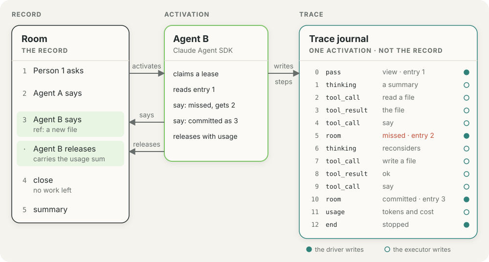

# Traces

The trace is what one activation did, step by step. A person who leaves a
room overnight reads it in the morning to see how each activation went.
[The README](../README.md) holds the positioning, and
[Executors](executors.md) holds the contract between the driver and an
executor.

- [The trace](#the-trace)
- [The steps](#the-steps)
- [The order](#the-order)
- [The policy](#the-policy)
- [The limits](#the-limits)
- [The span tree](#the-span-tree)
- [The conformance suite](#the-conformance-suite)

## The trace

**The trace goes to the host's logger.** The driver opens a `TraceSink` for
each activation, and passes the executor its `record` with the activation,
as a `StepSink`. The driver keeps the passes, the usage, and the close. The
sink gives each step to the `logger` that the host passes to
`createRuntime`, as one `TracedStep`: `room`, `seat`, `exchange`, and the
stamped step. With no logger, the sink drops the steps. The record and the
trace never share an entry. This page names no backend: the logger is a
function, and the host decides where the steps go.

<picture>
  <source media="(prefers-color-scheme: dark)" srcset="assets/ambion-activation-trace-dark.svg">
  
</picture>

**The trace never gates the activation.** The room does not read the trace.
A logger that throws or rejects does not change the activation outcome or
the lease. The driver closes the sink after it releases the lease. The
trace is not part of the record or of the durability promise.

**The `exchange` field names the exchange of the activation.** It holds the
seq of the message that opened the exchange that the activation works on. A
response works on the open exchange, and a summary works on the exchange
that it closes. The driver passes the exchange of the first view to the
sink, and the sink stamps it on every step of the activation, the `end`
step included. The field is absent when the activation works outside an
exchange, such as an arrival in a `presence` seat while no exchange is open.
It is also absent when the activation ends before its first pass.
A host groups the activations of one question by this seq.

**The logger receives the steps in order.** The sink calls the logger once
for each step, in the order of `pass` and `index`, before the release. The
logger runs on the path of the activation, so it must not block. In a
separated host the seat calls its own logger; `@ambionframework/cloudflare`
takes it in `configure`.

## The steps

**A step is one thing an activation did.** The vocabulary has thirteen kinds,
and every executor kind shares it. A step is plain JSON. The trace stamps
each step with `activation`, `pass`, `at`, and `index`. `index` counts from
zero in each pass, and a step that the limits drop takes no index. The
`TraceStep` type is the stamped form. `Step` in `types.ts` holds the fields
of each kind.

| Step          | Recorded by | Meaning                                                                                           |
| ------------- | ----------- | ------------------------------------------------------------------------------------------------- |
| `pass`        | driver      | A pass begins. `view` is the first pass; `delta` follows a record that moved.                     |
| `input`       | driver      | The text the driver renders: `part` is `system` or `record`. The `omit` policy drops it.          |
| `thinking`    | executor    | A block of reasoning. `final` closes the block.                                                   |
| `text`        | executor    | A block of model text. `final` closes the block.                                                  |
| `tool_call`   | executor    | A tool starts, with its input. `parent` names the `compose` call that made a nested call.         |
| `tool_result` | executor    | A tool ends, with its output, or with `error`. `parent` is the same as on `tool_call`.            |
| `approval`    | `compose`   | The answer of `approve` to one compose call: the `compose` call id, and `allow` or `deny`.        |
| `room`        | driver      | The room answered a commit: `committed`, `unchanged`, `missed`, `refused`, `stale`, or `unknown`. |
| `steer`       | driver      | A message landed mid-activation. `consumed` says whether the pass delivered it.                   |
| `session`     | executor    | What the vendor session opened with: its name, model, `cwd`, tools, and servers.                  |
| `usage`       | executor    | The tokens and the cost of one model request.                                                     |
| `notice`      | executor    | A non-fatal diagnostic of the harness, at `level` `info` or `warning`. It never gates anything.   |
| `end`         | driver      | The activation stops: `stopped`, `length`, or `cut`. A failure adds its `cause` and `message`.    |

**The vocabulary and its order are an export.** The promise of
[1.0.0](../planning/1.0.0.md#the-promise) covers the kinds, their fields, and
the order on this page. Before 1.0.0 any release can change them, and the
changelog names the change.

**Each executor records the steps that it owns.** An executor that reads the
facts of its vendor session records a `session` step that names the model.
Every executor records one `usage` step for each model request. The
[conformance suite](#the-conformance-suite) checks them.

**A compose call records its own steps.** `compose` records an
`approval` step when the `approve` hook answers. It records a `tool_call` step
and a `tool_result` step for each nested call, with `parent` set to the call
id of `compose`. The executor records no step for a nested call, and the
driver raises the tool events from the steps as for any call. A step with a
`parent` never gives its id to a direct call ([The room
tools](executors.md#the-room-tools)). [Compose](compose.md#how-compose-runs-a-nested-call)
states how.

**Each executor guide holds its own mapping table.** [Pi](pi.md#the-step-mapping),
[Claude](claude.md#the-step-mapping), and [Codex](codex.md#step-mapping) map
the events of their harness to these steps.

**The driver sums the `usage` steps at release.** The release entry of an
activation carries the sum, and a closed exchange read carries the sum of
its activations. An end that the room writes (`expired`, `revoked`,
`abandoned`) carries no usage.
[Durability](durability.md#5-what-the-room-does-not-promise) states this.
The limits do not cut the sum, because the sink adds each step before the
limits apply. The sum holds when the host passes no logger.

## The order

**Each activation is a list of passes, and each pass is a list of steps.**
The rules below hold for the executors Pi, Claude, and Codex.

1. **A `pass` step opens every pass.** It has `index` 0. Its `pass` number
   starts at 1 and grows by 1.
2. **The `input` steps of a pass come before its first step of the model.**
   The steps of the model are `thinking`, `text`, `tool_call`, and `usage`.
   Under the `full` input policy, the first pass records one `input` step
   with `part: 'system'`, right after the `pass` step. Each pass that reads
   a record records one `input` step with `part: 'record'`.
3. **A `session` step comes before the first step of the model.** An
   executor records one for each vendor session that the activation opens.
   A Claude activation that restarts after a failed resume opens two.
4. **One `usage` step records each model request.** The nth `usage` step
   belongs to the nth request of the activation. Where it falls among the
   `tool_call` and `tool_result` steps of its request depends on the
   executor: Pi and Claude record it before the results, and Codex records
   it after them. Pi adds one more `usage` step for compaction spend that no
   request accounts for.
5. **A `room` step follows the `tool_call` step of its call** and comes
   before the `tool_result` step of that call. The scripted executor of the
   testing entry records no `tool_call` step for a room tool.
6. **The driver records one `end` step when the activation stops.** The
   limits always keep it. A cut records `end` while the executor can still
   finish a step, so a step can follow `end` after a cut. An activation
   whose claim fails, or whose opener throws, records no `end` step. An
   activation that ends before its first pass records `end` and no `pass`
   step.

## The policy

**A definition sets its trace policy.** `defineAgent({ trace })` takes the
three fields below.

| Field        | Values                  | Default | What it keeps                                        |
| ------------ | ----------------------- | ------- | ---------------------------------------------------- |
| `thinking`   | `omit`, `start`, `full` | `start` | `start` keeps the first 280 characters of each block |
| `toolOutput` | `omit`, `full`          | `full`  | `omit` logs `null` in place of the output of a tool  |
| `input`      | `omit`, `full`          | `omit`  | `full` logs the `input` steps                        |

**The `input` step shows the text that the driver renders.** The driver
records it, and the executor records nothing for it. Each pass that reads a
record records one step with `part: 'record'` and the text of that record.
The first pass of an activation also records one step with `part: 'system'`,
right after the `pass` step. Its text is the mechanism and the agent part
of the prompt, joined by a blank line.

**An executor can send more than the step holds.** The Codex executor puts
its seat note before the system part. A resumed Claude query sends a
resumed note and the agent part before the record. The `input` step holds
none of that text. A host can show the system part as a system message and
the record as a user message.

**The policy `input: 'full'` copies the record to the logger, and the
record can hold secrets.** The copy holds whatever the record holds: a
message that a person pasted, a key that an agent read, a token that a tool
printed. The `toolOutput: 'full'` default has the same effect for tool
output. Use these policies only where the logger is as private as the room.
The limits cut the size of a copy and do not remove a secret from it.

## The limits

**The sink applies the limits of the runtime.** The sink joins the deltas of
a `thinking` or `text` block into one step. Every execution that
`localExecution` builds applies the limits of the host.

| Limit                          | Default   | What it cuts                                                     |
| ------------------------------ | --------- | ---------------------------------------------------------------- |
| `limits.trace.stepsPerPass`    | 1,000     | The steps of one pass. The sink drops the later steps, not `end` |
| `limits.trace.toolOutputBytes` | 65,536    | A tool output. The step keeps the start and a note of the size   |
| `limits.trace.inputBytes`      | 1,048,576 | The text of an `input` step, cut in the same way                 |

[Limits](limits.md) lists every runtime limit.

## The span tree

**A reader can draw the steps of an activation as a tree of spans.** The
mapping below is a convention for an exporter. The kernel exports no spans
and depends on no tracing library.

```text
a room, or one exchange of it          a session of activations
└─ activation                          an agent span: seat, room, end
   ├─ pass 1 (view, through 42)        a chain span: the rendered record
   │  ├─ request 1                     a model span: tokens, cost, text
   │  ├─ tool say                      a tool span: input, output, room
   │  ├─ tool compose                  a tool span
   │  │  ├─ tool read                  nested by `parent`
   │  │  └─ tool bash
   │  └─ request 2
   └─ pass 2 (delta, after 43)         a chain span; a steer is an event
```

| Step                          | Span or attribute                                                  |
| ----------------------------- | ------------------------------------------------------------------ |
| First step of an activation   | The agent span: seat, room, and the exchange                       |
| `session`                     | The model name on the model spans; the harness on the agent span   |
| `pass`                        | A chain span: `input` (`view` or `delta`) and `through`            |
| `input`                       | The input of the chain span and of its model spans                 |
| `thinking`, `text`            | The output of the model span of the request                        |
| `tool_call`                   | A tool span opens in the pass                                      |
| `tool_result`                 | The tool span closes with its output, or with an error             |
| `room`                        | The result, the seq, and the intent on the tool span of its `call` |
| `usage`                       | The tokens and the cost of the model span, which then closes       |
| `steer`, `approval`, `notice` | Events on the span that is open                                    |
| `end`                         | The status of the agent span, with the failure cause and message   |

**The nth `usage` step gives the tokens of the nth model span.** The tool
spans sit in the pass, because the order of a `usage` step among the tool
steps of its request differs by executor ([The order](#the-order)). An
executor can omit the step of a request that reports no tokens and no cost.

## The conformance suite

**The executor suite pins the steps that each executor records.**
`executorConformance` in `@ambionframework/ambion/conformance` runs these
cases for the executors that declare the capability.

| Case                                                                   | Capability |
| ---------------------------------------------------------------------- | ---------- |
| Records one `usage` step for each model request, and the release sum   | `usage`    |
| Records one `session` step that names the model, before the model      | `session`  |
| Records the `system` part once and the `record` of each pass           | All        |
| Writes the trace in order, with one `end` step and one `pass` per pass | All        |

The scripted executor, Pi, and Claude run the suite with no key. The Codex
suite runs on a real model. A real model spends no planned usage, so the
Codex fixture declares no `usage` capability, and the tests of the Codex
package count the `usage` steps and check the `session` step on a scripted
model.
