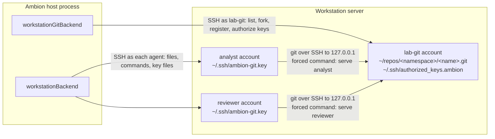

# A git backend on the workstation

**`@ambionframework/workstation` implements this page.**
`workstationGitBackend` is a second `GitBackend` for the
[git contract](git.md). It keeps the repositories on the
[workstation](workstation.md), in the home of one dedicated account, and
each agent reaches them with `git` over SSH.

**The backend reuses the SSH code of the package.** The client of the git
account is the same kind of SSH session, with the same environment over
SFTP and `exec`, that the bash backend opens for each agent. The backend
adds no dependency.

**This backend keeps the git traffic inside the server.** The agent's
`git` connects to the `sshd` of its own server, on the loopback address.
The host needs no listener. The host reaches the server over SSH, the same
as the bash backend does.

## The shape



**One account owns every repository.** The host names the account in the
`account` option. This page calls it `<workspace>-git`, such as `lab-git`.
Its home has mode `0700`, so no agent reads a repository from the disk.
Every read and every push goes through `sshd` and one forced command.

**Each agent holds one key for the git account.** The backend issues the
key, and the bash backend writes it into the agent's home. The git
account lists the public key with a forced command that names the agent.
The server reads the caller's name from that line.

**The host drives the git account over its own SSH client.** `list`,
`get`, `fork`, and template registration run as short scripts on the
server. The host runs no git library.

## Use

**The [package guide](../packages/workstation/README.md#the-git-backend)
shows the example and the options.** The `git` option of
`workstationBackend` takes the backend.

**The git account is on the workstation, and an agent reaches it on the
loopback address.** `server`, `port`, and `hostKey` name the one server of
both backends, and the host passes one value to both. Nothing compares the
two. A git backend on a server of another host key fails its first
operation at the host key check. A git server on a second machine is not
supported.

## The git account

**The layout of the home.** The paths below use the default `root`,
`repos`.

| Path                            | Holds                                                        | Mode   |
| ------------------------------- | ------------------------------------------------------------ | ------ |
| `~`                             | Everything below                                             | `0700` |
| `~/.ssh/authorized_keys`        | The host's key for the account. The operator writes it       | `0600` |
| `~/.ssh/authorized_keys.ambion` | One line for each agent key. The backend is its one writer   | `0600` |
| `~/.ambion/serve`               | The forced command of every agent key                        | `0700` |
| `~/.ambion/keys.lock`           | The lock of each write of `authorized_keys.ambion`           | `0600` |
| `~/repos/templates/<name>.git`  | Each template, a bare repository                             |        |
| `~/repos/<agent>/<name>.git`    | Each fork, a bare repository                                 |        |
| `~/repos/.staging/`             | Repositories in construction. No request reaches this folder |        |

**Two files hold the authorized keys, and each has one writer.** The
operator adds a `Match` block to `sshd_config`:

```text
Match User lab-git
  AuthorizedKeysFile .ssh/authorized_keys .ssh/authorized_keys.ambion
```

A fault in the backend's writes cannot remove the host's own key, so the
backend cannot lock itself out.

**The account is not in the agents' group.** It writes no audit entry and
no room mirror. A fault in the forced command gives an agent the rights of
the git account alone.

**The backend prepares the account once, before its first operation.**
It makes `~/.ambion` and `~/.ssh`, writes `serve` when its content
differs, removes the old staging folders, and registers the templates.
`serve` goes to a temporary name and then a rename, since `bash` reads a
script as it runs and a write in place can change a running copy. The
first `connect` of the git resource and the first `identityFor` await the
same preparation, so no key reaches `sshd` before its forced command
exists. A failed preparation lets the next caller try again.

**The backend refuses a home that a key line cannot hold.** The `command`
option of each key line names the path of `serve` with no quoting. The
preparation fails when the home holds a character other than a letter, a
digit, `.`, `_`, `-`, or `/`.

## The protocol

**A clone URL is `ssh://<alias>/<namespace>/<name>`.** For example,
`ssh://ambion-git/analyst/report`. The URL stays opaque to the agent. The `label` of the backend is
`ssh://ambion-git`, and the guidance names it.

**The agent's ssh configuration maps the alias to the server.** At each
`connect`, the bash backend writes three files into `~/.ssh` with mode
`0600`, and makes `Include ambion-git.conf` the first line of
`~/.ssh/config`. It makes `~/.ssh` with mode `0700` when it is absent,
and each temporary name lives in `~/.ssh`, so each rename stays on one
filesystem:

```text
# ~/.ssh/ambion-git.conf
Host ambion-git
  HostName 127.0.0.1
  Port 22
  User lab-git
  IdentityFile ~/.ssh/ambion-git.key
  IdentitiesOnly yes
  HostKeyAlias ambion-git
  UserKnownHostsFile ~/.ssh/ambion-git.known_hosts
  StrictHostKeyChecking yes
  BatchMode yes
```

- **`ambion-git.key`** holds the agent's private key.
- **`ambion-git.known_hosts`** holds one line: the alias and the server's
  host key. The backend takes the key that its own client verified
  against `hostKey`.
- **The `Include` line comes first,** because an `Include` after a `Host`
  block applies to that block alone.

**The agent needs no `git config` change.** A remote with the alias uses
the key. Every other remote keeps the agent's own ssh settings.

**Each agent key has one line in `authorized_keys.ambion`.**

```text
restrict,from="127.0.0.1,::1",expiry-time="20260924101230",command="/home/lab-git/.ambion/serve analyst" ssh-ed25519 AAAA... ambion:analyst
```

| Option        | Effect                                                                               |
| ------------- | ------------------------------------------------------------------------------------ |
| `restrict`    | No pty, no port forwarding, no agent forwarding, no X11                              |
| `from`        | The key works only from the loopback address. A copy of the key off the server fails |
| `expiry-time` | `sshd` refuses the key after this time, in the server's time zone                    |
| `command`     | `sshd` runs `serve <agent>` for every request, whatever the client asks              |

**`serve` is the one place that decides a request.** `sshd` puts the
client's command in `SSH_ORIGINAL_COMMAND`. `serve` accepts two forms and
refuses every other. With the default `root`, the backend writes this
script:

```bash
#!/usr/bin/env bash
set -euo pipefail
agent="$1"
re="^(git-upload-pack|git-receive-pack) '/?([a-z][a-z0-9-]*)/([a-z0-9][a-z0-9._-]{0,63})'$"
[[ "${SSH_ORIGINAL_COMMAND:-}" =~ $re ]] || { echo 'ambion: refused' >&2; exit 1; }
service="${BASH_REMATCH[1]}" namespace="${BASH_REMATCH[2]}" name="${BASH_REMATCH[3]}"
repo="$HOME/repos/$namespace/$name.git"
if ! [ -f "$repo/HEAD" ]; then
  echo "ambion: $namespace/$name does not exist" >&2; exit 1
fi
if [ "$service" = git-receive-pack ] && [ "$namespace" != "$agent" ]; then
  [ "$namespace" = shared ] || { echo "ambion: $agent cannot push to $namespace/$name" >&2; exit 1; }
fi
export GIT_COMMITTER_NAME="$agent" GIT_COMMITTER_EMAIL="$agent@ambion.invalid"
exec git "${service#git-}" "$repo"
```

- **The pattern is the ID rule of [Git](git.md#repositories-and-their-names).**
  A name holds no `/` and starts with no `.`, so no path leaves `~/repos`.
- **A push creates no repository.** `serve` refuses a path whose `HEAD`
  does not exist. Only `fork` and registration create a repository.
- **A push goes to the agent's namespace or `shared`.** No agent is named
  `templates` or `shared`, so no push reaches a template. Each template also has a
  `pre-receive` hook that refuses every push.
- **The committer variables name the agent in the reflog.** Each
  repository sets `core.logAllRefUpdates=always`. The reflog of each ref
  then records the agent that moved it, whatever `user.name` the agent
  set in its commits.

**A shared repository is published after its protection.** The backend
publishes `shared/<name>.git` only after the seed commit on `main` and its
`pre-receive` hook are installed. The hook refuses deletion or a
non-fast-forward update of the default branch. It checks original commit
ancestry with replacement objects disabled.
[Shared repositories](git.md#shared-repositories) states the contract.

## Keys

**The git backend issues each agent key.** `ssh2` generates an Ed25519
key pair in the OpenSSH format (`utils.generateKeyPairSync('ed25519')`). The key lives in the backend's memory and in the
agent's home. The host provisions no agent key for git.

**The key generator retries a pair that `ssh2` cannot read.** About once
in 256 pairs, the generator drops a leading zero byte of the public key,
and `utils.parseKey` refuses both halves. The backend parses each new
pair and generates again until both halves parse. It gives up after 64
pairs.

**The git backend owns the git key of each agent.** It issues the key,
rotates it, and the key works only on the server until it expires. The
host owns the key of each account on the server
([Workstation](workstation.md#credentials)).

**Each `connect` of the bash backend keeps the agent's files current.**

1. The bash backend calls `identityFor(agent)` on the git backend's
   access.
2. The git backend returns the key it holds for the agent. When it holds
   none, or the key is inside its margin, it generates a new one. It
   writes the new line to `authorized_keys.ambion` before it returns.
3. The bash backend reads the three files and the first line of
   `~/.ssh/config` in one command. It writes each one that differs, or
   that has a mode other than `0600`, through a temporary name,
   `chmod 600`, and `mv`.

**Two calls for one agent get one key.** A second `identityFor` for an
agent waits for the key that the first one issues. A failure of
`identityFor` or of the write of the files fails the `connect`.

**The server's clock and time zone decide the expiry.** OpenSSH 7.7
added `expiry-time`, and it reads the time in the server's time zone. The
`Z` suffix for UTC needs OpenSSH 9.1, and Ubuntu 22.04 ships 8.9. The
backend therefore runs one command on the server for each write: `date
+%s%3N` gives the server's time, and `date -d @<expiry> +%Y%m%d%H%M%S`
renders the expiry in the server's zone. `expiry-time` names the last
whole second that `sshd` accepts the key. The margin and the `expiresAt`
of the identity count from the server's time, so a skew between the two
clocks shortens no key. A local time in the hour that the end of daylight
saving time repeats is ambiguous to `sshd`, so a key can expire up to one
hour early or late on that day. The `command` path comes from the home
that the client reads once with `realpath('.')`.

**A key inside its margin counts as missing.** The margin is the smaller
of 10 minutes and half of the key's life. The key rotates about once each `credentialTtl`, and a command
that starts with a key keeps it for the length of the margin.

**An old line stays until its expiry.** The backend adds the new line and
keeps the old one, so a command in flight with the old key finishes.
Each write drops the lines whose `expiry-time` has passed. `sshd`
refuses an expired line on its own, so a late drop grants nothing.

**The server serializes the writes of `authorized_keys.ambion`.** Two
agents that connect at once each need a line, and two host processes can
overlap during a handover ([Deployment](deployment.md)). Each write is
one command on the server under `flock ~/.ambion/keys.lock`: read the
file, add the new line, drop the expired lines, write a temporary name in
`~/.ssh`, `chmod 600`, and rename. The lock orders the writes of every
host process, so no line is lost.

**A restart of the host issues new keys.** The keys live in memory. The
first `connect` of each agent after a restart writes a new key and a new
line. The old lines expire within `credentialTtl`.

## Repositories

**Each repository is a bare repository with its facts in its own
files.** The backend keeps no registry table.

| Fact                 | Where it lives                                                                          |
| -------------------- | --------------------------------------------------------------------------------------- |
| The ID               | The path: `~/repos/<namespace>/<name>.git`                                              |
| The source of a fork | `git config ambion.source <id>` in the repository                                       |
| The description      | The repository's own `description` file. The text that `git init` writes counts as none |
| The default branch   | `HEAD`                                                                                  |
| The branches         | `refs/heads/*`                                                                          |

**`list` and `get` run one command each.** The command prints one record
for each repository: the ID, `HEAD`, each branch with its commit, the
source, and the description. The backend parses the records into
`GitRepository` values. It skips `.staging`.

**A fork builds in `.staging` and lands with one rename.**

1. `git clone --bare <source> ~/repos/.staging/<random>`. The source and
   the fork are on one filesystem and have one owner, so the clone
   hard-links the object files. A fork costs little disk.
2. Remove the `origin` remote, set `ambion.source`, and set
   `core.logAllRefUpdates`.
3. `mkdir -p ~/repos/<agent>` and `mv -T` the staging folder to
   `<agent>/<name>.git`. `rename(2)` refuses a target folder that holds
   files, so a second fork of one name fails and gets `name_taken`.

**A taken name costs no clone.** The backend reads the source and the
target before it clones, and a taken name gets `name_taken` at once. In
one host process, a second fork of one target waits for the first. The
rename decides between two host processes.

**A hard link keeps each fork whole.** A fork shares no object store with
its source. A `gc` of the source removes nothing that the fork reads. A
fork of a fork works the same as a fork of a template.

**A crash leaves a folder in `.staging` and no half repository.** The
rename is the one step that publishes a repository. The backend removes
each staging folder older than one hour at its first operation. The
`forking` state and the settle step of `justGitBackend` have no counterpart.

**An abort kills the fork's command.** The environment over SSH kills the
process group ([Workstation](workstation.md#commands-and-aborts)). The
staging folder stays until the next sweep. A repeated `fork` is safe, the
same as on `justGitBackend`.

**Registration builds a repository in `.staging` and renames it into its
folder.** [Git](git.md#templates) states the decisions: the name rule, the
path rule, the three cases of a template, and the read after each write.
This backend implements the storage steps.

- **A read of a template runs `git ls-tree -r` on its tip.** The step gives
  the blob hashes at the tip, and `registerRepositories` compares them. The
  script writes the description when it differs.
- **A new template or a new shared repository is a bare repository.** The
  backend writes the files into a staging folder over SFTP, and commits
  them to a new bare repository on `main` as `ambion`. It writes the
  description and installs the `pre-receive` hook. It renames the
  repository to `templates/<name>.git` or `shared/<name>.git`.
- **A changed template takes a commit on its tip.** The backend writes the
  files into a staging folder over SFTP and commits them on the tip of
  `main` as `ambion`. `git update-ref` then moves `main` to that commit,
  and it compares the old commit.

**A commit of registration adds every file with `git add -A --force`.** A
`.gitignore` in the source then skips no file, and the tip holds the blob
hashes of the source.

**A refused move of `main` names the error of git.** When `git update-ref`
fails, such as for a lock, the step throws with the message of git.
[Git](git.md#templates) states when the registration still succeeds. The
next registration moves `main`.

## The registration helpers

**The registration helpers live in the workspace package.**
`registerRepositories`, `RegistrationSteps`, `filesOf`, `hashesOf`,
`sameFiles`, `changeTo`, `RepositoryRegistration`, and the name rules are
in `@ambionframework/workspace/git`. `fromDirectory` and the source types
are in the root entry. Both entries load `node:fs` and `node:crypto` and no
git library, so the workstation installs no `just-git`. `tipHashes` reads
`just-git/repo`, so it stays in just-bash.

## Resources and order

**The git resource runs `list`, `get`, and `fork` on the git account's
client.** The client holds one SFTP channel. An operation opens one
`exec` channel, and an abort opens one more.

**`identityFor` does not take the git resource.** It runs from the bash
backend's `connect`. It awaits the preparation of the account, then reads
the key from memory. A new key adds one write of `authorized_keys.ambion`
on the git account's client, with one `exec` channel.

**A clone or a push holds no resource in the host.** The pack work runs
between two processes on the server. The bash resource still waits for the
`bash` call that runs `git`, as it waits for any command.

## Persistence

**The code and the working copies share one failure domain.** With
`justGitBackend`, the code lives in a SQLite file on the host. With this
backend, the code stays on the server beside the working copies. The host
backs up `~lab-git/repos` with its own tools, such as a filesystem
snapshot or one `git bundle` for each repository.
[Git](git.md#persistence) states what survives a restart.

## Trust

[Git](git.md#trust) holds the table of attempts for both backends. The
forced command `serve`, the key line options, and the mode of the git home
decide the workstation column.

## Limits

- **One account owns every repository.** One filesystem quota covers all
  agents together. No quota applies to one agent. A flood of pushes fills the
  disk of the server.
- **The backend serves protocol version 0.** Version 2 needs
  `AcceptEnv GIT_PROTOCOL` in `sshd`. Version 0 serves every operation of
  the contract.

## Prepare the server

**The operator adds one account and one `Match` block.** The other steps
of [the package guide](../packages/workstation/README.md) do not change.

- **One account `<workspace>-git`,** with a login shell of `bash`, a home
  of mode `0700`, and no place in the group of the agents.
- **The host's key for it** in `~/.ssh/authorized_keys`.
- **The `Match User` block** that adds `authorized_keys.ambion`.
- **`AllowUsers`, when it is set,** names the account.
- **`git` and `openssh-client`** on the server. An agent runs `ssh` to
  reach the account.
- **OpenSSH 7.7 or newer** for `expiry-time`. `restrict` needs 7.2.
- **GNU coreutils and util-linux:** `mv -T`, `date -d`, and `flock`.
  The workstation already needs `setsid` from util-linux.
- **One writer of the account's key file at a time** holds without the
  operator: every host process takes `flock` on the server.
